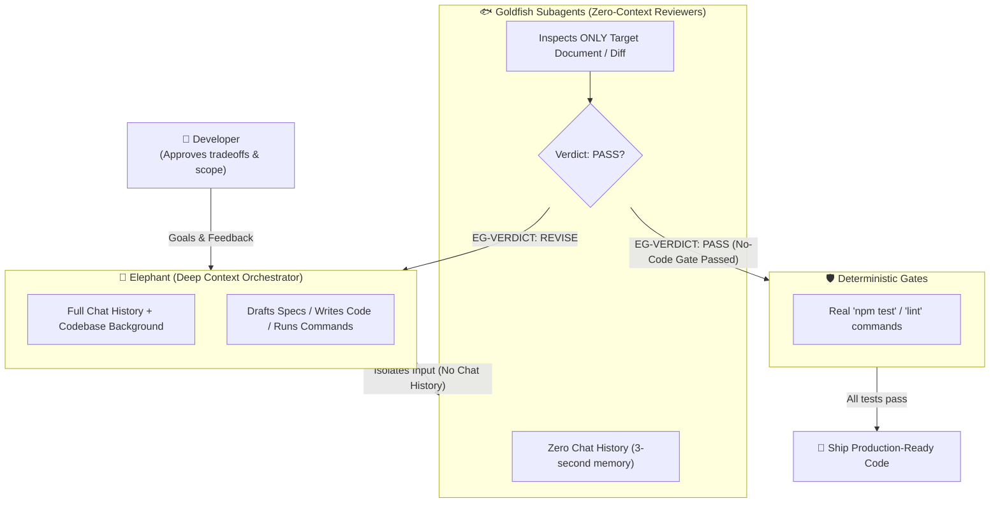

# Elephant-Goldfish (EG) for GitHub Copilot

<p align="center">
  <a href="LICENSE"></a>
  
  
  
  <a href="https://github.com/google/elephant-goldfish-model"></a>
</p>

A practical software engineering template bringing the **Elephant-Goldfish (EG)** workflow into **GitHub Copilot in VS Code**.

- **Elephant**: An orchestrator agent holding the full conversation context, repository history, and domain background. It writes specifications and code, runs tests, and interacts directly with you.
- **Goldfish**: Zero-context, read-only subagents that start fresh without prior chat history. They evaluate documents and diffs with complete objectivity, catching unstated assumptions, ambiguities, and architectural blind spots that familiarity obscures.

Inspired by Google's [Elephant-Goldfish Model](https://github.com/google/elephant-goldfish-model) (see the [Google Open Source Blog announcement](https://opensource.googleblog.com/2026/10/introducing-elephant-goldfish-model-plugin.html)), Dave Rensin's foundational essay, and Vladyslav Shvedov's MIT fork. While the original model focused on drafting design documents in CLI harnesses, this template is **natively adapted for GitHub Copilot in VS Code**, extending the workflow across the entire development lifecycle (PRD, feature implementation, bug fixing, and pre-commit reviews).

---

## Architecture & The Pack System

This template decouples the workflow into a **3-Layer Model**, offering complete extensibility without modifying core rules:

```text
.github/
├── eg/
│   ├── protocol.md             # Layer 1: Core Protocol (EG-owned, immutable workflow rules)
│   ├── packs/<pack>.md         # Layer 2: Pack Manifests (defines goldfish lineups & stage rounds)
│   └── profile.md              # Layer 3: Project Profile (project-owned; points to docs & test commands)
├── agents/
│   ├── elephant.agent.md       # Orchestrator agent
│   └── goldfish-*.agent.md     # Specialized read-only goldfish reviewers
├── skills/eg-*/SKILL.md        # Copilot workflow skills (/eg-*)
└── copilot-instructions.md     # Injected EG instructions block
```

### Extensibility via Pack Inheritance (`extends`)

Rather than locking you into a fixed set of reviewers, EG uses **Packs**. You can extend the built-in `general` pack to create custom review perspectives (e.g., security, infrastructure, performance, ML) in seconds.

Create `.github/eg/packs/security-first.md`:

```markdown
# EG Pack: security-first
description: General development with strict security gates
extends: general
max-rounds: prd=3, design=3, review=5

| stage | lens | goldfish | use |
|---|---|---|---|
| design | security | goldfish-myteam-security | required |
| review | security | goldfish-myteam-security | required |
| design | comprehension | - | off |
```

- **Stage types**:
  - `gate`: Goldfish must end with `EG-VERDICT: PASS` or `REVISE`. Every required goldfish must pass before proceeding.
  - `compare`: Goldfish diagnoses independently (`EG-DONE`). Elephant compares its hypothesis against goldfish findings.
  - `generate`: Goldfish brainstorms or explores independently (`EG-DONE`). Elephant synthesizes results.
- **`use` modes**:
  - `required`: Must pass every review round to clear the gate.
  - `info`: Runs in the first round for informational feedback only (never blocks).
  - `pool`: Candidate list selected collaboratively with the user (e.g. during brainstorming).
  - `off`: Disables and removes an inherited reviewer row.

---

## Installation & Quickstart

### Supported Environments

Verified with the **Copilot** and **Local** harnesses in VS Code Chat.
*(When using the Local harness, ensure the `Run Subagent` (`agent/runSubagent`) tool is enabled in your tool settings).*

### 1. Install into a Project

Run the installer pointing to your target project:

```sh
./install.sh /path/to/project
```

- **Safe installation**: Existing files are never overwritten.
- **Clean integration**: Appends only the `<!-- EG:BEGIN -->` ... `<!-- EG:END -->` block to `.github/copilot-instructions.md`.
- **Git clean**: Automatically adds `.eg-work/` (temporary working directory) to `.gitignore`.
- **Updating**: Run `./install.sh /path/to/project --update` to refresh EG core files without touching your custom packs, goldfish, or `profile.md`.

*(For manual setup, copy `.github/` to your project root and add `.eg-work/` to `.gitignore`.)*

### 2. Quickstart

> [!IMPORTANT]
> **The Golden Rule**: Always select the **`elephant`** agent in VS Code Chat before running any `/eg-*` skill. In GitHub Copilot, skills inherit the toolset of the currently selected agent. Only `elephant` has permissions to delegate to goldfish subagents, modify files, and run commands.

1. Open your project folder as the workspace root in VS Code.
2. In Chat, switch the active agent to **`elephant`**.
3. Run `/eg-setup` to automatically inspect the codebase, identify test/lint commands, and configure `.github/eg/profile.md`.

---

## Skills & Workflows

### Selecting a Pack per Task

Skills automatically use the `default-pack` defined in `.github/eg/profile.md` (defaults to `general`). To use a specialized pack, specify its name as the **first word** of your command:

```text
# Uses the default pack ('general')
/eg-new-feature add OAuth2 login

# Uses the 'security-first' pack (.github/eg/packs/security-first.md)
/eg-new-feature security-first add OAuth2 login
```

> [!TIP]
> The first word is parsed as a pack name **only if** an exact matching file exists in `.github/eg/packs/<pack>.md`. Otherwise, the entire input is safely treated as the task description.

### Available Skills

| Skill | Lifecycle Stage | What It Does |
|---|---|---|
| `/eg-setup` | Setup | Scans the repository, discovers documentation and test commands, and drafts `.github/eg/profile.md` for your confirmation. |
| `/eg-brainstorm [pack] <idea>` | Ideation | Runs parallel goldfish reviewers across diverse perspectives (contrarian, technical, UX, business) and synthesizes the insights. |
| `/eg-prd [pack] <idea>` | Planning | Performs codebase grounding, surfaces architectural gaps, conducts targeted research, and drafts a PRD verified by a readiness gate. |
| `/eg-new-feature [pack] <task>` | Implementation | **Enforces No-Code Gate**: Writes a design doc, iterates until goldfish approves design, implements phase-by-phase, reviews diffs, and runs deterministic test gates. |
| `/eg-fix-bug [pack] <issue>` | Bug Fixing | **Unbiased Diagnosis**: Formulates an elephant hypothesis, collects independent goldfish diagnoses without anchoring bias, adds a failing test, implements the fix, and verifies. |
| `/eg-precommit-review [focus]` | Verification | Packages pending changes into diffs, executes configured deterministic gates (lint/test), and conducts iterative goldfish code review rounds. |

### Key Guarantees

* **No-Code Gate (`/eg-new-feature`)**: Elephant refuses to write code in `src/` until the design document clears goldfish review.
* **Unbiased Compare Stage (`/eg-fix-bug`)**: Goldfish diagnosticians receive only symptoms and reproduction steps—never Elephant's hypotheses—ensuring genuinely independent analysis.
* **Deterministic Verification**: AI judgment is paired with actual test and lint execution (`npm test`, `pytest`, `cargo test`, etc.) defined in your project profile.
* **Diff Isolation**: Reviewers are read-only and inspect generated `.eg-work/review-round<N>.diff` files (with fallback snapshot diffing for non-git environments).

---

## Customizing Packs & Writing Goldfish Agents

You can create project-specific reviewers by adding agent files to `.github/agents/goldfish-<pack>-<lens>.agent.md`.

### Guidelines for Goldfish Agents

1. **Strict read-only permissions**: Always set `tools: ['read', 'search']` and `user-invocable: false` in the frontmatter. Add `'web'` only for research agents.
2. **Context bootstrap**: Instruct the agent to read `.github/copilot-instructions.md` and `.github/eg/profile.md` as its first step.
3. **Structured verdict**: End gate reviewers with exactly `EG-VERDICT: PASS` or `EG-VERDICT: REVISE` (or `EG-DONE` for exploration/diagnosis).

Example (`.github/agents/goldfish-myteam-security.agent.md`):

```markdown
---
name: goldfish-myteam-security
description: Security review lens for authentication and data flow.
tools: ['read', 'search']
user-invocable: false
---
# goldfish-myteam-security

## 0. Read first
Read `.github/copilot-instructions.md` and `.github/eg/profile.md`.

## 1. Stance
You are a fresh, zero-context security reviewer. Evaluate only the input diff and referenced files.

## 2. Output
List numbered security vulnerabilities (OWASP top 10, auth bypass, injection risks).
Last line, exactly one of:
EG-VERDICT: PASS | EG-VERDICT: REVISE
```

---

## Documentation & References

- [docs/DESIGN.md](docs/DESIGN.md): Detailed architectural design and probe results.
- [docs/VALIDATION.md](docs/VALIDATION.md): Empirical test scenarios and validation matrix.
- [harness-probe/README.md](harness-probe/README.md): Probe test kit for validating agent harness capabilities.

---

## Architecture & Lifecycle Diagram



---

## License & Credits

This project is licensed under the [MIT License](LICENSE).

### Acknowledgments

- **Google LLC**: For the original [Elephant-Goldfish Model](https://github.com/google/elephant-goldfish-model) (Apache 2.0) and Dave Rensin's foundational concept of dual-agent context asymmetry.
- **Vladyslav Shvedov**: For the early [elephant-goldfish](LICENSE.elephant-goldfish) MIT fork exploring multi-harness agent patterns.
- **Jin Heo**: For the Copilot-native architecture, 3-layer pack inheritance system, empirical harness probes, and full development lifecycle workflows.
